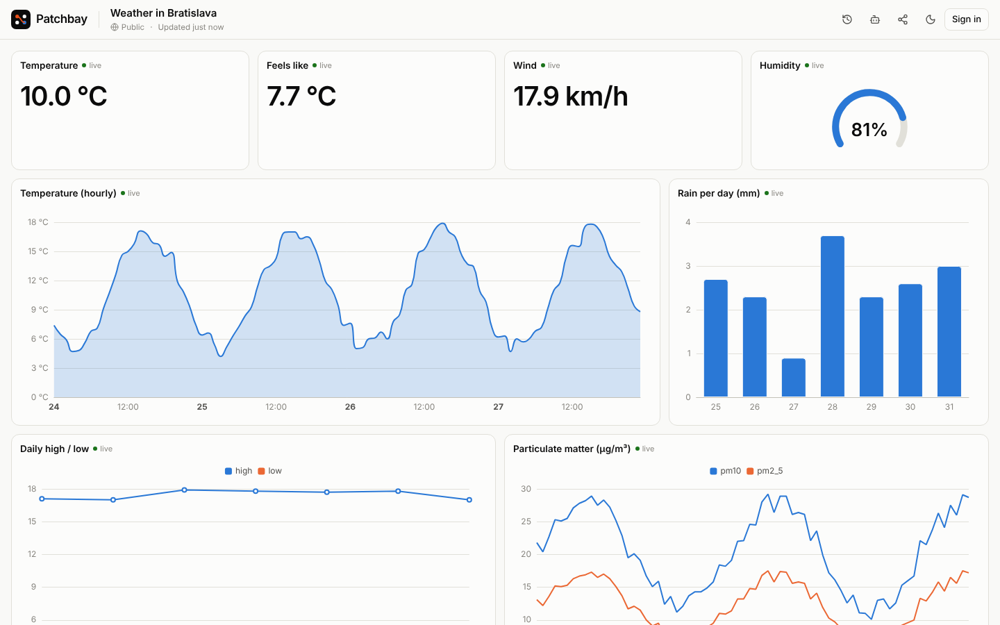
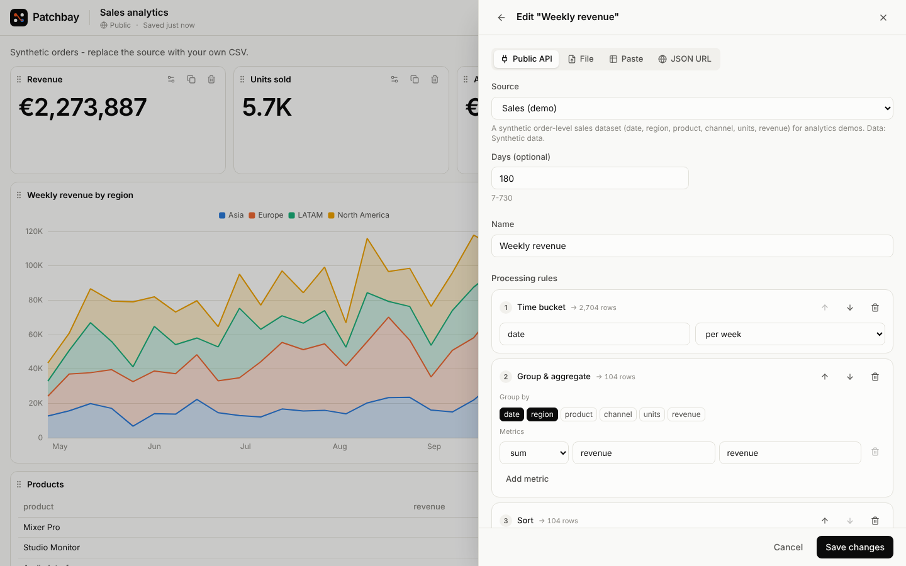
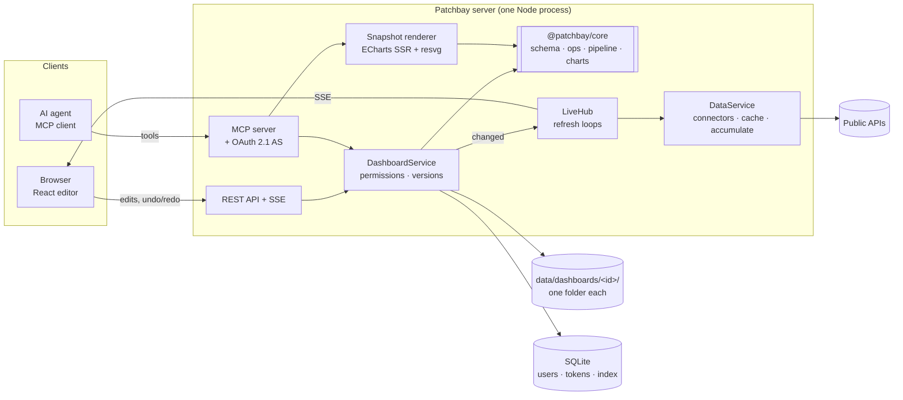

<div align="center">


# Patchbay

**Patch any data into a live dashboard. Your AI agent does the wiring.**

Public APIs and your own CSVs, processed by declarative rules, rendered as real-time dashboards,
and built either by hand or by an AI agent over the [Model Context Protocol](https://modelcontextprotocol.io).

[](https://github.com/carnaby/patchbay/actions/workflows/ci.yml)


</div>



> In a recording studio, a _patchbay_ is the panel where you wire any source into any device with short cables.
> This is that panel for data: sources on one side, widgets on the other, and processing rules in between.

## Why it exists

Most dashboard tools assume a human clicks every chart into place. Patchbay is **AI-first**: its primary
interface is an MCP server that lets an agent such as Claude create dashboards, inspect your data, propose
how to process it, apply the changes, and then **look at a rendered image of the result** to fix what it got
wrong. Everything the agent can do, a person can do in the editor as well, with undo/redo.

It is free, needs no API keys, and runs as a single process you can host anywhere.

## Highlights

- 🤖 **MCP-native.** 14 tools, 2 prompts and a reference resource. OAuth 2.1 (PKCE, dynamic registration, Client ID
  Metadata Documents) for real clients, personal access tokens for scripts and development.
- 👀 **Agents can see.** `render_snapshot` returns a PNG of the dashboard, rendered server-side with the same chart
  code the browser uses, so the agent can check its own work.
- ⚡ **Real time.** Datasets refresh on the server while someone is watching and are pushed over Server-Sent Events,
  only when the data actually changed. "Current value" sources can accumulate into live time series.
- 🧪 **Declarative processing.** Filter, derive, group/aggregate, time buckets, rolling windows and more, with a small
  sandboxed expression language (no `eval`, ever). The same pipeline runs for the browser, the agent and the renderer.
- 💡 **Suggestions without an LLM.** A rules engine profiles any dataset (time, measures, dimensions, coordinates…)
  and proposes fitting widgets with a one-line rationale. Agents get the same suggestions as ready-to-apply operations.
- ↩️ **Undo everything.** Undo/redo in the editor, a version for every save, one-click restore. When an agent changes
  a dashboard you have open, the change appears live, highlighted, with an _Undo_ button.
- 🔐 **Yours.** Sign in with Google; dashboards are private or public. Anyone can build a public dashboard without an
  account and claim it later.
- 🗂️ **Boring storage.** One folder per dashboard. Delete the folder and the dashboard is gone. SQLite only indexes.
- 🌗 **Accessible charts.** Colour-blind-validated palette, light and dark themes, no dual axes, tables as an
  alternative view, keyboard shortcuts.

<table>
<tr>
<td width="50%"></td>
<td width="50%"></td>
</tr>
<tr>
<td align="center"><sub>Processing rules with row counts per step</sub></td>
<td align="center"><sub>Second-by-second live data, dark theme</sub></td>
</tr>
</table>

## Quick start

Requirements: Node.js 22.18+ (24 recommended) and pnpm 10.

```bash
git clone https://github.com/carnaby/patchbay.git
cd patchbay
pnpm install
cp .env.example .env          # works as-is: dev login on, no Google keys needed
pnpm dev                      # API on :8787, web app on http://localhost:5173
```

Open <http://localhost:5173>, click **Build a dashboard**, pick a template. To work without internet access, set
`OFFLINE=1`: every connector then serves deterministic synthetic data with the real shape.

### Connect Claude

1. Sign in (in development: any email via the dev login).
2. **Claude (web or desktop):** _Settings → Connectors → Add custom connector_, URL `http://localhost:5173/mcp`
   (your `PUBLIC_URL` + `/mcp`). You will be sent to Patchbay to approve the connection.
3. **Claude Code:**

   ```bash
   claude mcp add --transport http patchbay http://localhost:5173/mcp
   ```
4. Clients without OAuth: create a personal access token under _Settings_ and send it as
   `Authorization: Bearer pb_pat_…`.

Then ask, for example:

> _Build me a Patchbay dashboard about earthquakes this week: where they happen, how strong they are, and a daily trend.
> Check the snapshot and fix anything that looks off._

## How an agent builds a dashboard

An illustrative session (tool calls abbreviated):

```text
you    › Build a dashboard comparing the weather in Bratislava and Vienna.
agent  › get_reference · list_connectors
       › preview_data { connector: weather.forecast, city: Bratislava }       → columns, profile, suggestions
       › create_dashboard { title: "Bratislava vs Vienna" }                    → id, URL
       › apply_operations [addDataset ×2, addWidget ×5]                         → version 2, data checks OK
       › render_snapshot                                                        → 🖼  (sees an empty chart: wrong column)
       › apply_operations [updateWidget { config: { y: ["temperature_2m"] } }]  → version 3
       › render_snapshot                                                        → 🖼  looks right
       › "Done: https://…/d/x7k2…  Vienna is 2 °C warmer on average."
```

The browser showing that dashboard updates live while this happens. Each step is a version; the user can undo any of
them. The snapshot the agent sees looks like this:


Full tool reference: [docs/mcp.md](docs/mcp.md).

## Architecture



The core idea: **one validated operation layer**. The browser editor, the REST API and the MCP agent all change
dashboards through `applyOps` from `@patchbay/core` (pure, framework-free, unit-tested). An operation batch is atomic,
validated by strict Zod schemas plus integrity checks, versioned, and broadcast to everyone watching. The editor applies
the same function locally, so it can never produce a document the server would reject, and it can replay unsaved edits
on top of a newer version when an agent saved in between.

Key decisions and their trade-offs are written up in [docs/architecture.md](docs/architecture.md). The short version:

| Decision                                         | Why                                                                                              | Trade-off                                                                                |
| ------------------------------------------------ | ------------------------------------------------------------------------------------------------ | ---------------------------------------------------------------------------------------- |
| Hono + Node, React SPA, one process              | Folder storage needs a persistent disk anyway, so serverless buys nothing. One image to deploy.  | Scales vertically, not horizontally.                                                     |
| Folder per dashboard, SQLite as an index         | Matches the brief ("delete the folder and it is gone"), trivially backed up, human-inspectable.  | Single writer per dashboard (in-process lock).                                           |
| Semantic ops instead of document PUTs for agents | Small, reviewable, id-addressed changes that are easy for a model to produce and safe to rebase. | Two write paths (ops and full save) to keep consistent; both end in the same validation. |
| Pipelines run on the server                      | Browser, agent and PNG renderer see identical numbers; upstream APIs are cached and shared.      | Server CPU per refresh (bounded by row caps).                                            |
| Own expression interpreter                       | User and agent supplied logic without code execution.                                            | A deliberately small language.                                                           |
| ECharts                                          | Canvas performance on large series, and an SSR renderer for agent snapshots.                     | Larger bundle than SVG chart libraries (split into its own chunk).                       |
| No LLM inside the server                         | Free to run, no keys to leak; the user's own agent brings the intelligence over MCP.             | Built-in suggestions are rules-based.                                                    |

## Data sources

All built-in connectors are free and need no API key. Responses are cached per parameter set for at least the
interval shown, so many viewers cost one upstream request.

| Connector                                                    | Data                                                                                       | Min. cache |
| ------------------------------------------------------------ | ------------------------------------------------------------------------------------------ | ---------- |
| `weather.forecast`, `weather.current`, `weather.air-quality` | [Open-Meteo](https://open-meteo.com) forecasts, current conditions, air quality (any city) | 5–30 min   |
| `crypto.markets`, `crypto.price`, `crypto.history`           | [CoinGecko](https://www.coingecko.com) markets, spot prices, history                       | 1–5 min    |
| `fx.rates`                                                   | ECB reference rates via [Frankfurter](https://frankfurter.dev)                             | 1 h        |
| `earthquakes`                                                | [USGS](https://earthquake.usgs.gov) real-time feed                                         | 1 min      |
| `iss.position`                                               | Where the International Space Station is now                                               | 5 s        |
| `worldbank.indicator`                                        | [World Bank](https://data.worldbank.org) development indicators                            | 1 day      |
| `wikipedia.pageviews`                                        | Daily page views of Wikipedia articles                                                     | 6 h        |
| `hackernews.stories`                                         | Top/new/best stories                                                                       | 3 min      |
| `github.repo`                                                | Stars, forks and issues of public repositories                                             | 15 min     |
| `npm.downloads`                                              | Daily npm downloads                                                                        | 6 h        |
| `demo.signal`, `demo.sales`                                  | Synthetic live signal and sales data (always offline)                                      | 1 s        |

Plus your own data: **CSV/JSON uploads** (stored in the dashboard's folder), **inline rows**, and **any public HTTPS
JSON endpoint** (behind an SSRF guard). Adding a connector is one file: parameters, a `fetch`, and a `sample` for
offline mode. See `apps/server/src/connectors/`.

## Processing rules

A dataset is `source → transforms → rows`. Transforms are JSON, stored with the dashboard and validated before they run:

```jsonc
[
  { "type": "filter", "expr": "magnitude >= 4 && !contains(place, \"test\")" },
  { "type": "derive", "as": "energy", "expr": "round(pow(10, 1.5 * magnitude + 4.8) / 1e12, 2)" },
  { "type": "timeBucket", "field": "time", "unit": "day" },
  {
    "type": "aggregate",
    "groupBy": ["time"],
    "metrics": [{ "op": "count", "as": "quakes" }, { "op": "max", "field": "magnitude" }]
  },
  { "type": "window", "op": "rolling_avg", "field": "quakes", "size": 3 }
]
```

Available steps: `filter`, `derive`, `select`, `drop`, `rename`, `sort`, `limit`, `aggregate` (count, count_distinct,
sum, avg, min, max, median, stddev, first, last), `timeBucket` (minute to year), `window` (rolling_avg, rolling_sum,
cumsum, diff, pct_change, rank) and `fillNull`. Expressions support arithmetic, comparisons, `and/or/not`, ternaries
and 34 whitelisted functions (`round`, `coalesce`, `contains`, `year`, `daysAgo`, …). The editor shows the row count
after every step.

## Security model

- Every write is validated (strict schemas, integrity checks, size limits) and versioned; agents cannot run code or delete dashboards.
- Private dashboards are invisible (404) to everyone but their owner; anonymous dashboards are public and editable only
  with an edit key that never leaves the creator's browser except as a header.
- OAuth 2.1 with mandatory PKCE, exact redirect matching (loopback ports per RFC 8252), tokens bound to the MCP
  resource (RFC 8707), rotating refresh tokens with reuse detection, consent screen, revocable connections.
  All secrets are stored as SHA-256 hashes.
- Cookie writes require a same-origin `Origin`; strict CSP; rate limits per IP and per user; `DEV_LOGIN` refuses to
  start unless `PUBLIC_URL` is localhost.
- User-supplied URLs: HTTPS only, private/reserved ranges blocked including IPv6 forms that embed IPv4 (mapped, NAT64,
  6to4); the check runs inside the socket's DNS lookup (no DNS-rebinding window); redirects re-checked; size and time
  capped.
- Markdown is rendered without raw HTML; SVG text in snapshots is escaped.
- Resource limits everywhere: request bodies (1 MB, uploads 8 MB), uploads per dashboard (20 files / 25 MB), new
  dashboards per IP, open live streams per IP, and a time and cell budget for every pipeline run (expression strings
  are capped, so no step can blow up memory).
- Tokens are bound by their scopes on every interface, and admin rights are never granted to tokens.
- Live streams are re-authorised when access changes: making a dashboard private disconnects everyone else.
- The server was reviewed adversarially before release; every finding has a regression test
  (`apps/server/src/server.test.ts`, "hardening").

## Configuration

| Variable                                   | Default                 | Purpose                                                              |
| ------------------------------------------ | ----------------------- | -------------------------------------------------------------------- |
| `PUBLIC_URL`                               | `http://localhost:8787` | Canonical origin; OAuth issuer and MCP resource are derived from it. |
| `PORT`, `HOST`                             | `8787`, `0.0.0.0`       | Where the server listens.                                            |
| `DATA_DIR`                                 | `./data`                | Dashboard folders and `patchbay.db`.                                 |
| `GOOGLE_CLIENT_ID`, `GOOGLE_CLIENT_SECRET` | –                       | Google sign-in. Redirect URI: `PUBLIC_URL/auth/google/callback`.     |
| `ADMIN_EMAILS`                             | –                       | Comma-separated emails with access to `/admin`.                      |
| `DEV_LOGIN`                                | off                     | Passwordless login for development. Refused in production.           |
| `OFFLINE`                                  | off                     | Serve synthetic connector data.                                      |
| `PRUNE_ANONYMOUS_AFTER_DAYS`               | `0`                     | Auto-delete anonymous dashboards nobody opened for N days.           |
| `TRUST_PROXY`                              | off                     | Use `X-Forwarded-For` for rate limiting behind a reverse proxy.      |

## Deployment

One container with a volume. A production-style `docker-compose.yml` with Caddy (automatic HTTPS) is included:

```bash
cp .env.example .env   # set GOOGLE_*, ADMIN_EMAILS, DEV_LOGIN=0
PATCHBAY_DOMAIN=dash.example.com docker compose up -d
```

Options and recommendations (VPS, Fly.io, Railway…) are in [docs/deployment.md](docs/deployment.md).

## Project layout

```text
packages/core     Pure domain logic shared by server and browser: schemas, ops, layout, expression
                  language, transform pipeline, profiling, suggestions, chart option builders. Unit-tested.
apps/server       Hono server: auth, OAuth AS, REST + SSE, MCP, connectors, folder store, PNG renderer.
apps/web          React 19 + Vite SPA: landing, editor (undo/redo, live sync), settings, admin.
docs/             Architecture notes, MCP reference, deployment guide.
```

## Development

```bash
pnpm test        # Vitest: core unit tests + server integration tests (OAuth flow, MCP tools via the official client)
pnpm typecheck   # TypeScript, strict, in every package
pnpm lint        # Biome
pnpm build       # production build of the web app
pnpm start       # serve API + built web app on one port
```

The server runs TypeScript directly with Node's type stripping, so there is no build step on the backend.

## Roadmap

- Dashboard-level filters and variables (date range, city) that agents can bind widgets to.
- A map widget for coordinate data.
- Shared editing with named collaborators.
- Scheduled snapshots (daily PNG to email/Slack).
- Postgres-backed index for multi-instance deployments.

## License

[MIT](LICENSE). Data from third-party APIs is subject to their own terms; attributions are shown in the editor.
Screenshots in this README were taken in `OFFLINE` mode, so the numbers in them are synthetic.
