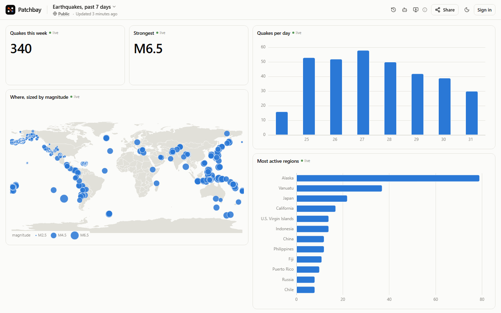
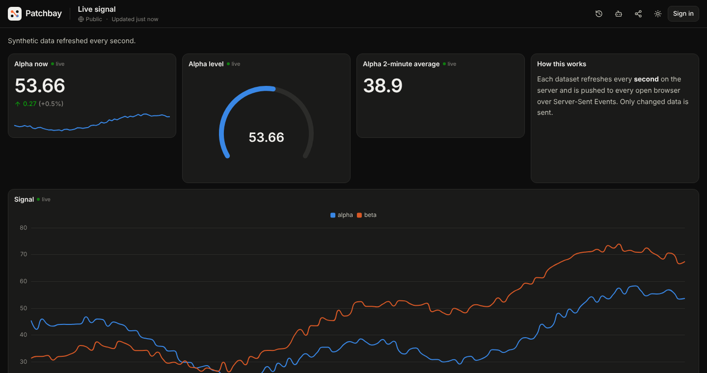
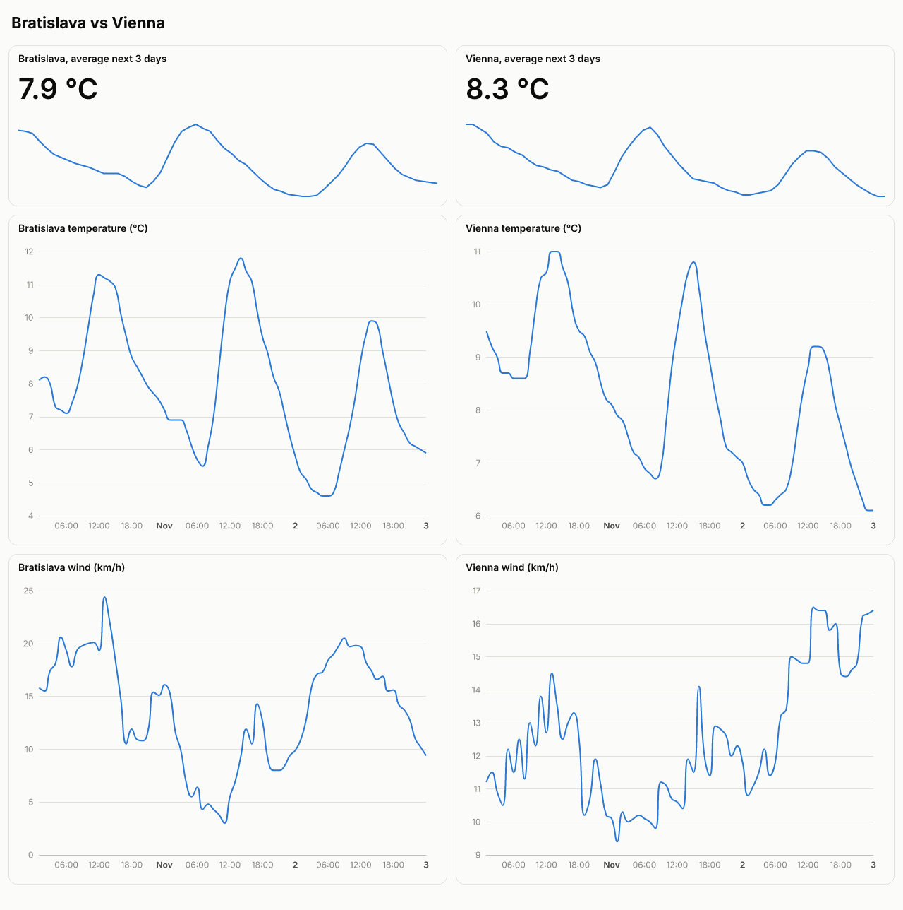
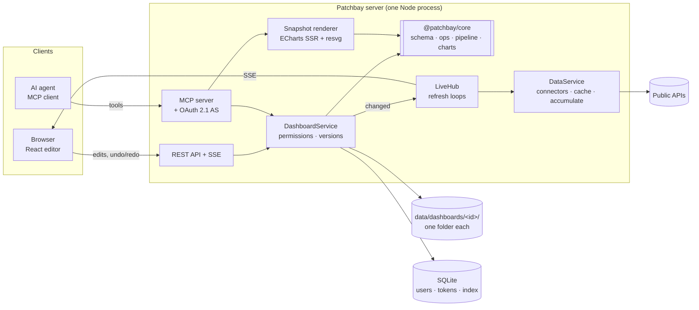

<div align="center">


# Patchbay

**Patch any data into a live dashboard. Your AI agent does the wiring.**

Public APIs and your own CSVs, processed by declarative rules, rendered as real-time dashboards,
and built either by hand or by an AI agent over the [Model Context Protocol](https://modelcontextprotocol.io).

### [Try it live → patchbay.me.uk](https://patchbay.me.uk)

No sign-up needed to build a dashboard. To let your agent build one, add `https://patchbay.me.uk/mcp` as a
connector ([how](#connect-your-agent)).

[](https://github.com/carnaby/patchbay/actions/workflows/ci.yml)


</div>

**Who it is for:** anyone who wants something between heavy BI and monitoring tools (Grafana, Metabase) and static
homelab start pages (Homepage, Dashy). Patchbay is a declarative data pipeline with the speed of a notebook, and an AI
agent's work ends as a live, shareable dashboard instead of a chat answer. The agent checks its own work by looking
at a server-rendered snapshot of the dashboard.



> In a recording studio, a _patchbay_ is the panel where you wire any source into any device with short cables.
> This is that panel for data: sources on one side, widgets on the other, and processing rules in between.

## Why it exists

Most dashboard tools assume a human clicks every chart into place. Patchbay is **AI-first**: its primary
interface is an MCP server that lets an agent such as Claude create dashboards, inspect your data, propose
how to process it, apply the changes, and then **look at a rendered image of the result** to fix what it got
wrong. Everything the agent can do, a person can do in the editor as well, with undo/redo.

It is free, needs no API keys, and runs as a single process you can host anywhere.

## Highlights

- 🤖 **MCP-native.** 15 tools, 2 prompts and a reference resource. OAuth 2.1 (PKCE, dynamic registration, Client ID
  Metadata Documents) for real clients, personal access tokens for scripts and development.
- 👀 **Agents can see.** `render_snapshot` returns a PNG of the dashboard, rendered server-side with the same chart
  code the browser uses, so the agent can check its own work.
- ⚡ **Real time.** Datasets refresh on the server while someone is watching and are pushed over Server-Sent Events,
  only when the data actually changed. "Current value" sources can accumulate into live time series.
- 🧪 **Declarative processing.** Filter, derive, group/aggregate, time buckets, rolling windows and more, with a small
  sandboxed expression language (no `eval`, ever). The same pipeline runs for the browser, the agent and the renderer,
  in worker threads when the data is large.
- ↩️ **Undo everything.** Undo/redo in the editor, a version for every save, one-click restore. When an agent changes
  a dashboard you have open, the change appears live, highlighted, with an _Undo_ button.
- 🏠 **Wall screens and start pages.** Maps, clocks, news feeds and a search box next to the charts. Presentation mode
  (press `F`, or `/d/<id>?present=1`) runs unattended on a TV; set a dashboard as your browser's home page and ask
  your agent to add whatever you find.

<details>
<summary><b>More features</b></summary>

- 🧷 **Concurrent editing.** Pipeline steps have stable ids, so an agent and a person can edit different steps of the
  same pipeline at the same time; unsaved edits are replayed on top of an agent's newer version.
- 💡 **Suggestions without an LLM.** A rules engine profiles any dataset (time, measures, dimensions, coordinates…)
  and proposes fitting widgets with a one-line rationale. Agents get the same suggestions as ready-to-apply operations.
- 🗺️ **Maps without tiles.** Points (earthquakes, stations) and tracks (the ISS) on a bundled world map, sized and
  coloured by value, with optional day/night shading. No tile server and no third-party requests, so maps work
  offline and in agent snapshots.
- 📰 **News and start-page widgets.** Clocks (digital or analog, any time zone), headlines from any RSS, Atom or JSON
  feed, and a search box.
- 📺 **Made for wall screens.** In presentation mode the toolbar and cursor hide and the Screen Wake Lock keeps the
  display on. Any widget can be maximised.
- 🔔 **Sound cues.** A widget can play a short built-in sound when its live data changes: a bell when a new order
  arrives, an alert when a price crosses a threshold. Synthesised in the browser (no audio files), edge-triggered,
  never on load, with a cooldown, a global throttle and a per-screen mute.
- 📱 **Installable.** A lightweight PWA: install it on a phone, tablet or desktop and it opens in its own window.
  Deliberately not offline-first, since live data needs the network; the service worker only caches the immutable
  build assets and shows a friendly offline page.
- 🔐 **Yours.** Sign in with Google; dashboards are private or public. Anyone can build a public dashboard without an
  account and claim it later.
- 🔑 **Private APIs, when the operator allows it.** Save an API key once under Settings → Secrets and let a JSON URL
  dataset use it. Encrypted at rest, only ever sent to the address it was saved for, never readable again, not even by
  agents. Off by default (`SECRETS`); self-host for sensitive data, because the operator can technically read it.
- 🗂️ **Boring storage.** One folder per dashboard. Delete the folder and the dashboard is gone. SQLite only indexes.
- 🎬 **Use cases on the landing page.** Tabs with a short video, the prompt that built the dashboard, a live
  read-only example and a one-click editable copy. Add your own by dropping a folder into `showcase/`.
- 🌗 **Accessible charts.** Colour-blind-validated palette, light and dark themes, no dual axes, tables as an
  alternative view, keyboard shortcuts.

</details>

<table>
<tr>
<td width="50%"></td>
<td width="50%"></td>
</tr>
<tr>
<td align="center"><sub>Processing rules with row counts per step</sub></td>
<td align="center"><sub>Second-by-second live data, dark theme</sub></td>
</tr>
</table>

## Quick start

**Hosted:** open [patchbay.me.uk](https://patchbay.me.uk), click **Build a dashboard** and pick a template. Dashboards
made without an account are public; sign in with Google to keep private ones and to connect an agent.

**Docker, on your machine:**

```bash
docker run -d -p 8787:8787 -v patchbay-data:/data ghcr.io/carnaby/patchbay:latest
```

Open <http://localhost:8787>. Without Google credentials nobody can sign in, so this gives you anonymous public
dashboards only; add `-e GOOGLE_CLIENT_ID=… -e GOOGLE_CLIENT_SECRET=…` (redirect URI
`http://localhost:8787/auth/google/callback`) to sign in and connect agents. For a public server with HTTPS, see
[Deployment](#deployment).

**From source** (for development): Node.js 22.18+ (24 recommended) and pnpm 10 (`corepack enable`). Works on Linux,
macOS and Windows; there are no native add-ons to compile (SQLite is Node's built-in `node:sqlite`).

```bash
git clone https://github.com/carnaby/patchbay.git
cd patchbay
pnpm install
cp .env.example .env          # works as-is: dev login on, no Google keys needed
pnpm dev                      # API on :8787, web app on http://localhost:5173
```

Open <http://localhost:5173>, click **Build a dashboard**, pick a template. To work without internet access, set
`OFFLINE=1`: every connector then serves deterministic synthetic data with the real shape.

<a id="mcp"></a>

## Connect your agent

The MCP endpoint is your Patchbay address plus `/mcp`: `https://patchbay.me.uk/mcp` on the hosted instance,
`http://localhost:5173/mcp` in development. Agents work on your private dashboards, so connecting needs a signed-in
account: Google sign-in on a real deployment (set `GOOGLE_CLIENT_ID` and `GOOGLE_CLIENT_SECRET`), any email through
the dev login in development. Anonymous public dashboards in the browser need neither.

- **Claude (web and desktop):** _Settings → Connectors → Add custom connector_ with the `/mcp` URL. Custom
  connectors are called from Anthropic's cloud, not from your computer, so the URL must be public HTTPS:
  `https://patchbay.me.uk/mcp`, your own deployment, or a tunnel to your machine. `localhost` does not work here.
- **Claude Code** runs on your machine, so `localhost` works:

  ```bash
  claude mcp add --transport http patchbay https://patchbay.me.uk/mcp   # or http://localhost:5173/mcp
  ```

  Then run `/mcp` in Claude Code, pick _patchbay_ and sign in.
- **Other MCP clients with remote HTTP servers and OAuth** (Cursor, VS Code, Windsurf, ChatGPT developer mode, …):
  add the `/mcp` URL as a remote server; the client discovers the OAuth flow from the `401` challenge and sends you
  to Patchbay to approve the connection.
- **Clients without OAuth, scripts and CI:** create a personal access token under _Settings_ and send it as
  `Authorization: Bearer pb_pat_…`.

Then ask, for example:

> _Build me a Patchbay dashboard about earthquakes this week: where they happen, how strong they are, and a daily trend.
> Check the snapshot and fix anything that looks off._

Full tool reference: [guide/mcp.md](guide/mcp.md).

## How an agent builds a dashboard

An illustrative session (tool calls abbreviated):

```text
you    › Build a dashboard comparing the weather in Bratislava and Vienna.
agent  › get_reference · list_connectors
       › preview_data { connector: weather.forecast, city: Bratislava }       → columns, profile, suggestions
       › create_dashboard { title: "Bratislava vs Vienna" }                    → id, URL
       › apply_operations [addDataset ×2, addWidget ×6]                         → version 2, data checks OK
       › render_snapshot                                                        → 🖼  (sees an empty chart: wrong column)
       › apply_operations [updateWidget { config: { y: ["temperature_2m"] } }]  → version 3
       › render_snapshot                                                        → 🖼  looks right
       › "Done: https://…/d/x7k2…  Vienna is 0.4 °C warmer on average over the next three days."
```

The browser showing that dashboard updates live while this happens. Each step is a version; the user can undo any of
them. The final snapshot the agent sees (a PNG drawn on the server, live Open-Meteo data):



## Architecture



The core idea: **one validated operation layer**. The browser editor, the REST API and the MCP agent all change
dashboards through `applyOps` from `@patchbay/core` (pure, framework-free, unit-tested). An operation batch is atomic,
validated by strict Zod schemas plus integrity checks, versioned, and broadcast to everyone watching. The editor applies
the same function locally, so it can never produce a document the server would reject, and it can replay unsaved edits
on top of a newer version when an agent saved in between.

Key decisions and their trade-offs are written up in [guide/architecture.md](guide/architecture.md). The short version:

| Decision                                         | Why                                                                                              | Trade-off                                                                                |
| ------------------------------------------------ | ------------------------------------------------------------------------------------------------ | ---------------------------------------------------------------------------------------- |
| Hono + Node, React SPA, one process              | Folder storage needs a persistent disk anyway, so serverless buys nothing. One image to deploy.  | Scales vertically, not horizontally.                                                     |
| Folder per dashboard, SQLite as an index         | Deleting the folder deletes the dashboard; trivially backed up, human-inspectable.               | Single writer per dashboard (in-process lock).                                           |
| Semantic ops instead of document PUTs for agents | Small, reviewable, id-addressed changes that are easy for a model to produce and safe to rebase. | Two write paths (ops and full save) to keep consistent; both end in the same validation. |
| Pipelines run on the server                      | Browser, agent and PNG renderer see identical numbers; upstream APIs are cached and shared.      | Server CPU per refresh (bounded by row caps).                                            |
| Own expression interpreter                       | User and agent supplied logic without code execution.                                            | A deliberately small language.                                                           |
| ECharts                                          | Canvas performance on large series, and an SSR renderer for agent snapshots.                     | Larger bundle than SVG chart libraries (split into its own chunk).                       |
| No LLM inside the server                         | Free to run, no keys to leak; the user's own agent brings the intelligence over MCP.             | Built-in suggestions are rules-based.                                                    |

## Data sources

Sixteen built-in connectors: fourteen read free public APIs that need no API key, and two generate synthetic demo
data. Responses are cached per parameter set for at least the interval shown, so many viewers cost one upstream
request. The editor names each connector's data source next to its parameters.

| Connector                                                    | Data                                                                                       | Min. cache |
| ------------------------------------------------------------ | ------------------------------------------------------------------------------------------ | ---------- |
| `weather.forecast`, `weather.current`, `weather.air-quality` | [Open-Meteo](https://open-meteo.com) forecasts, current conditions, air quality (any city) | 5–30 min   |
| `crypto.markets`, `crypto.price`, `crypto.history`           | [CoinGecko](https://www.coingecko.com) markets, spot prices, history                       | 1–5 min    |
| `fx.rates`                                                   | ECB reference rates via [Frankfurter](https://frankfurter.dev)                             | 1 h        |
| `earthquakes`                                                | [USGS](https://earthquake.usgs.gov) real-time feed                                         | 1 min      |
| `iss.position`                                               | Where the International Space Station is now                                               | 5 s        |
| `worldbank.indicator`                                        | [World Bank](https://data.worldbank.org) development indicators                            | 1 day      |
| `wikipedia.pageviews`                                        | Daily page views of Wikipedia articles                                                     | 6 h        |
| `hackernews.stories`                                         | Top/new/best stories                                                                       | 3 min      |
| `github.repo`                                                | Stars, forks and issues of public repositories                                             | 15 min     |
| `npm.downloads`                                              | Daily npm downloads                                                                        | 6 h        |
| `demo.signal`, `demo.sales`                                  | Synthetic live signal and sales data (always offline)                                      | 1 s        |

Plus your own data: **CSV/JSON uploads** (stored in the dashboard's folder), **inline rows**, **any HTTPS JSON
endpoint** (behind an SSRF guard), and **any public news feed** (RSS, Atom or JSON Feed; a site's home page is enough
when it announces one), fetched at most every 5 minutes per address. Endpoints that need a key use a **secret** saved under
Settings → Secrets, sent as a bearer token, a header or a query parameter, and only to the origin and path prefix it is bound to; the instance
switch `SECRETS` decides who may store them. Adding a connector is one file: parameters, a `fetch`, and a `sample` for
offline mode. See `apps/server/src/connectors/`.

## Processing rules

A dataset is `source → transforms → rows`. Transforms are JSON, stored with the dashboard and validated before they run:

```jsonc
[
  { "type": "filter", "expr": "magnitude >= 4 && !contains(place, \"test\")" },
  { "type": "derive", "as": "energy", "expr": "round(pow(10, 1.5 * magnitude + 4.8) / 1e12, 2)" },
  { "type": "timeBucket", "field": "time", "unit": "day" },
  {
    "type": "aggregate",
    "groupBy": ["time"],
    "metrics": [{ "op": "count", "as": "quakes" }, { "op": "max", "field": "magnitude" }]
  },
  { "type": "window", "op": "rolling_avg", "field": "quakes", "size": 3 }
]
```

Available steps: `filter`, `derive`, `select`, `drop`, `rename`, `sort`, `limit`, `aggregate` (count, count_distinct,
sum, avg, min, max, median, stddev, first, last), `timeBucket` (minute to year), `window` (rolling_avg, rolling_sum,
cumsum, diff, pct_change, rank) and `fillNull`. Expressions support arithmetic, comparisons, `and/or/not`, ternaries
and a whitelist of math, text and date functions (`round`, `coalesce`, `contains`, `year`, `daysAgo`, …). The editor shows the row count
after every step.

## Security model

- Every write is validated (strict schemas, integrity checks, size limits) and versioned; agents cannot run code or delete dashboards.
- Private dashboards are invisible (404) to everyone but their owner; anonymous dashboards are public and editable only
  with an edit key that never leaves the creator's browser except as a header.
- OAuth 2.1 with mandatory PKCE, exact redirect matching (loopback ports per RFC 8252), tokens bound to the MCP
  resource (RFC 8707), rotating refresh tokens with reuse detection, consent screen, revocable connections.
  Tokens are stored as SHA-256 hashes; data source secrets are encrypted with AES-256-GCM and never readable.
- Secrets for HTTP sources are bound to an origin and path prefix (checked on every request hop, redirects included),
  resolved only against the dashboard owner's secrets, never accepted on anonymous dashboards, and echoed values are
  redacted from data. Agents can use but never read, create or change them, and cannot publish data fetched with them.
- Cookie writes require a same-origin `Origin`; strict CSP; rate limits per IP (IPv6 per /64, new dashboards and
  OAuth registrations per /56) and per user; `DEV_LOGIN` refuses to start unless `PUBLIC_URL` is localhost.
- User-supplied URLs: HTTPS only, IANA special-purpose ranges blocked (IPv6 only within global unicast), including IPv6
  forms that embed IPv4 (mapped, translated, NAT64, Teredo, 6to4); the check runs inside the socket's DNS lookup (no
  DNS-rebinding window); redirects re-checked; size and time capped.
- Markdown is rendered without raw HTML; SVG text in snapshots is escaped.
- Resource limits everywhere: request bodies (1 MB; 8 MB for uploads and MCP), upload files (5 MB and 500,000
  cells, 200,000 on anonymous dashboards), uploads per dashboard (20 files / 25 MB as stored), documents (1 MB), new
  dashboards per IP, open live streams per IP, snapshots per client, a memory guard, and a time and cell budget for
  every pipeline run. The full list is in [guide/deployment.md](guide/deployment.md#limits-for-a-small-public-instance).
- Tokens are bound by their scopes on every interface, and admin rights are never granted to tokens.
- Live streams are re-authorised when access changes: making a dashboard private disconnects everyone else.
- Analytics are opt-in per instance. The hosted instance at patchbay.me.uk counts page views with cookieless
  [Umami](https://umami.is) analytics that never sends query strings, fragments, dashboard IDs or dashboard titles and
  respects Do Not Track; see its [privacy page](https://patchbay.me.uk/privacy). A self-hosted instance has no
  analytics unless its operator sets `UMAMI_SCRIPT_URL` and `UMAMI_WEBSITE_ID`.
- The server was reviewed adversarially before release; every finding has a regression test
  (`apps/server/src/server.test.ts`, "hardening").

## Configuration

| Variable                                   | Default                       | Purpose                                                                                                     |
| ------------------------------------------ | ----------------------------- | ----------------------------------------------------------------------------------------------------------- |
| `PUBLIC_URL`                               | `http://localhost:8787`       | Canonical origin; OAuth issuer and MCP resource are derived from it.                                        |
| `PORT`, `HOST`                             | `8787`, `0.0.0.0`             | Where the server listens.                                                                                   |
| `DATA_DIR`                                 | `./data`                      | Dashboard folders and `patchbay.db`.                                                                        |
| `GOOGLE_CLIENT_ID`, `GOOGLE_CLIENT_SECRET` | –                             | Google sign-in. Redirect URI: `PUBLIC_URL/auth/google/callback`.                                            |
| `ADMIN_EMAILS`                             | –                             | Comma-separated emails with access to `/admin`.                                                             |
| `DEV_LOGIN`                                | off                           | Passwordless login for development. Refused in production.                                                  |
| `SHOWCASE_DIR`                             | `showcase/` in the repository | Folder with the landing page use cases (`/app/showcase` in Docker). An empty folder turns the showcase off. |
| `OFFLINE`                                  | off                           | Serve synthetic connector data.                                                                             |
| `PRUNE_ANONYMOUS_AFTER_DAYS`               | `0`                           | Auto-delete anonymous dashboards nobody opened for N days.                                                  |
| `PRUNE_BLANK_ANONYMOUS_AFTER_HOURS`        | `0`                           | Auto-delete anonymous dashboards still blank N hours after creation.                                        |
| `ANONYMOUS_STORAGE_LIMIT_MB`               | `1024`                        | Disk space all anonymous dashboards may take together; `0` = no limit.                                      |
| `USER_STORAGE_LIMIT_MB`                    | `500`                         | Disk space one signed-in user's dashboards may take; `0` = no limit. Administrators are exempt.             |
| `TRUST_PROXY`                              | off                           | `1`: IP from `X-Forwarded-For`; `cloudflare`: from `CF-Connecting-IP`                                       |
| `URL_SOURCES`                              | `everyone`                    | `signed-in`: http and feed sources load only for dashboards owned by a signed-in user.                      |
| `PIPELINE_WORKERS`                         | CPUs − 1, max 4               | Worker threads for data processing; `0` processes on the main thread.                                       |
| `PIPELINE_TIMEOUT_MS`                      | `10000`                       | Hard time limit for one pipeline run in a worker.                                                           |
| `MEMORY_LIMIT_MB`                          | the container's limit         | Memory the memory guard measures against; `0` turns the guard off.                                          |
| `MEMORY_SOFT_FRACTION`                     | `0.8`, less when small        | Above this share of it, new heavy work gets 503 and Retry-After.                                            |
| `MEMORY_HARD_FRACTION`                     | `0.9`, less when small        | Above this share, writes and new live streams get 503 too.                                                  |
| `SECRETS`                                  | `off`                         | Who may store credentials for HTTP sources: `off`, `admins`, `users`.                                       |
| `SECRETS_KEY`                              | –                             | 32 random bytes, base64. Required unless `SECRETS=off`.                                                     |
| `SECRETS_KEY_PREVIOUS`                     | –                             | Old key(s) during rotation, comma-separated.                                                                |
| `UMAMI_SCRIPT_URL`, `UMAMI_WEBSITE_ID`     | –                             | Optional Umami page-view analytics; both or neither.                                                        |

Upload, cache and worker memory limits (`UPLOAD_MAX_CELLS`, `DATA_CACHE_MB`, `PIPELINE_WORKER_MEMORY_MB`, …) are
described in [guide/deployment.md](guide/deployment.md#limits-for-a-small-public-instance) and `.env.example`.

## Deployment

One container with a volume. Images are published to GHCR: `ghcr.io/carnaby/patchbay:latest` follows `main`,
release tags (`0.1.0`, `0.1`) stay fixed, and every commit is also tagged with its full SHA.

A production-style `docker-compose.yml` with Caddy (automatic HTTPS) is included. Point a DNS record at the server,
then:

```bash
cp .env.example .env   # set PATCHBAY_DOMAIN, GOOGLE_CLIENT_ID/SECRET, ADMIN_EMAILS
docker compose up -d
```

The compose file sets `PUBLIC_URL`, `DATA_DIR`, `DEV_LOGIN=0` and `TRUST_PROXY` itself, so the development values in
`.env` do not leak into the container.

Options and recommendations (VPS, a home server or NAS behind a Cloudflare Tunnel, Fly.io, Railway…) are in
[guide/deployment.md](guide/deployment.md).

## Project layout

```text
packages/core     Pure domain logic shared by server and browser: schemas, ops, layout, expression
                  language, transform pipeline, profiling, suggestions, chart option builders. Unit-tested.
apps/server       Hono server: auth, OAuth AS, REST + SSE, MCP, connectors, folder store, PNG renderer.
apps/web          React 19 + Vite SPA: landing, editor (undo/redo, live sync), settings, admin.
guide/            Architecture notes, MCP reference, deployment guide, ideas for contributors.
```

## Development

```bash
pnpm test        # Vitest: core and web unit tests + server integration tests (OAuth flow, MCP tools via the official client)
pnpm typecheck   # TypeScript, strict, in every package
pnpm lint        # Biome
pnpm build       # production build of the web app
pnpm start       # serve API + built web app on one port (production mode)
```

The server runs TypeScript directly with Node's type stripping, so there is no build step on the backend.

## Roadmap

- Incremental live updates (send appended rows instead of whole tables): specified in
  [guide/ideas/0001-sse-deltas.md](guide/ideas/0001-sse-deltas.md), not implemented yet.
- Dashboard-level filters and variables (date range, city) that agents can bind widgets to.
- Shared editing with named collaborators.
- Scheduled snapshots (daily PNG to email/Slack).
- Postgres-backed index for multi-instance deployments.

## Contributing

Issues and pull requests are welcome; see [CONTRIBUTING.md](CONTRIBUTING.md) for the setup and the rules of the
codebase, and [guide/ideas/](guide/ideas/) for specified ideas waiting for someone to build them. Please report
security problems privately, as described in [SECURITY.md](SECURITY.md).

## License

[MIT](LICENSE). Data from third-party APIs is subject to their own terms; attributions are shown in the editor.
Third-party components and their licences are listed in [THIRD_PARTY_NOTICES.md](THIRD_PARTY_NOTICES.md). The hero
image and the agent snapshot show live data from USGS and Open-Meteo; the two smaller screenshots were taken in
`OFFLINE` mode, so their numbers are synthetic.

The base map of the map widget is [Natural Earth](https://www.naturalearthdata.com/) 1:110m Admin 0 – Countries
(version 5.1.2, public domain); see [packages/core/geo/README.md](packages/core/geo/README.md). The PNG renderer
bundles the Inter typeface under the SIL Open Font License (apps/server/src/render/fonts/LICENSE.txt).
